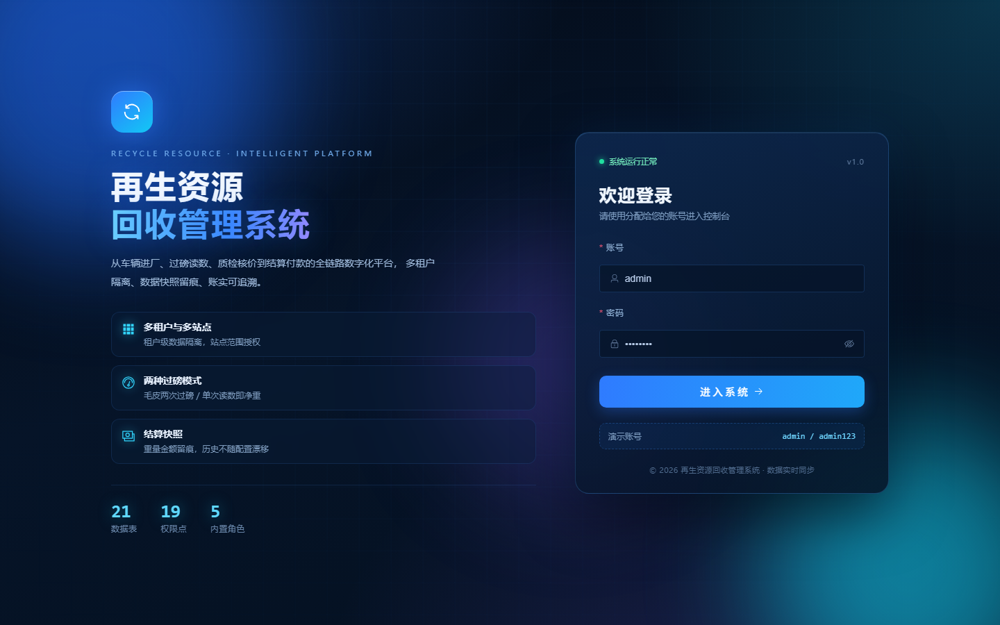
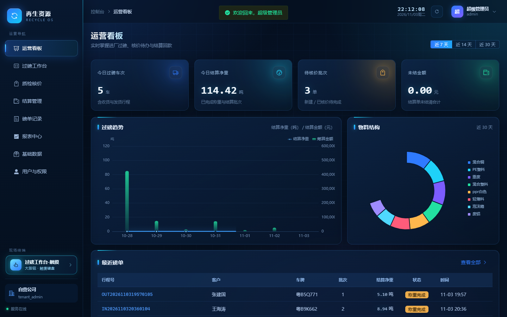
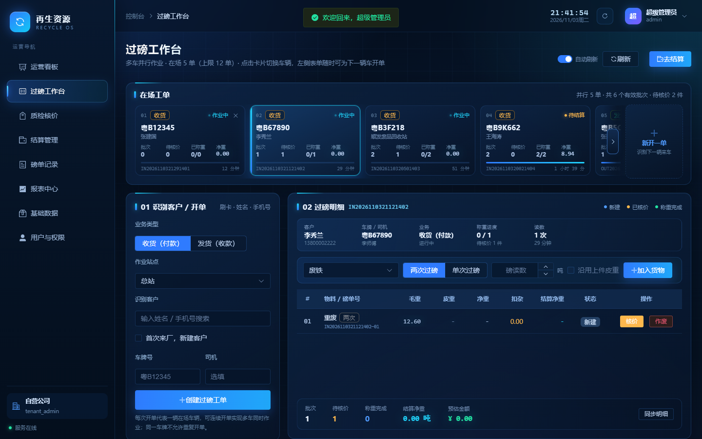
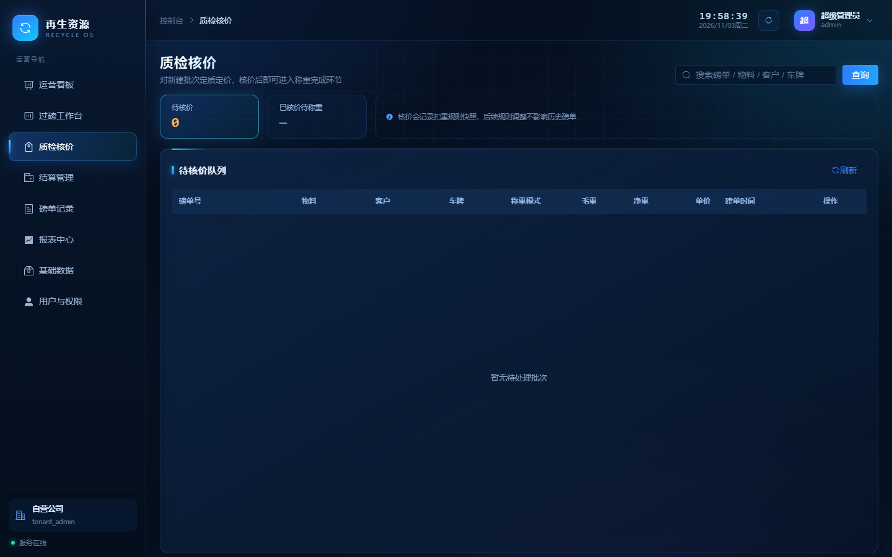
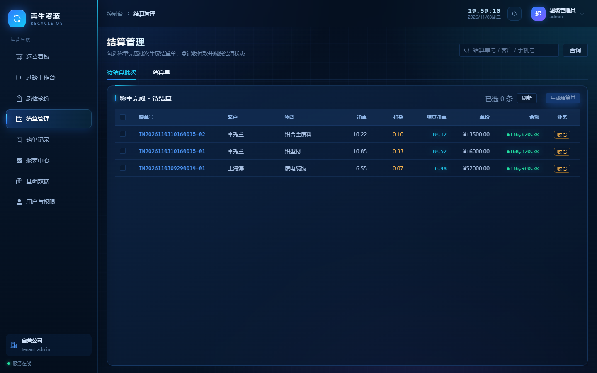
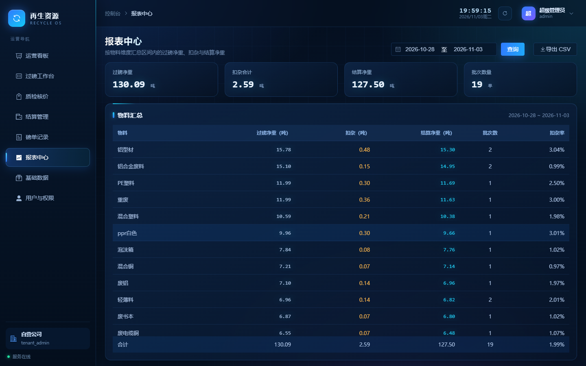
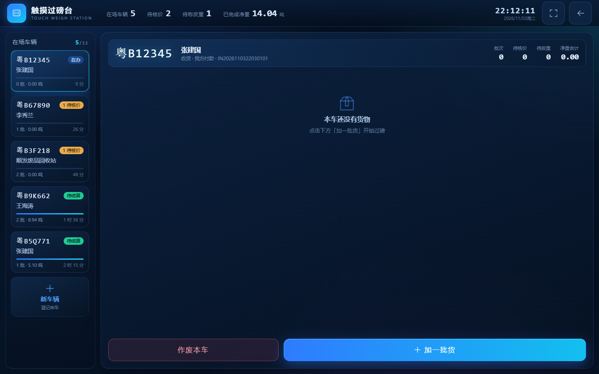
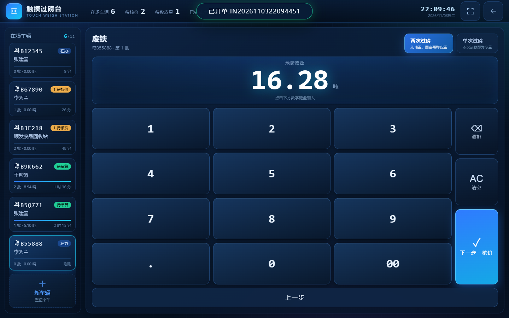

# 再生资源回收管理系统

面向废品回收站点的「过磅 → 质检核价 → 称重完成 → 结算付款」全流程系统。
前后端分离，多租户隔离，蓝色科技风控制台。

- **后端**：Python 3.12 + FastAPI + SQLAlchemy 2.0 + MySQL 8（`backend/`）
- **前端**：Vue 3 + Vite + Pinia + Element Plus + ECharts（`frontend/`）
- **数据库**：腾讯云 MySQL `RecycleWaste`（21 张表）

---

## 界面预览

| 登录 | 运营看板 |
|---|---|
|  |  |

| 过磅工作台（多车并行） | 质检核价 |
|---|---|
|  |  |

| 结算管理 | 报表中心 |
|---|---|
|  |  |

| 触摸工作台（零键盘） | 触摸录入磅读数 |
|---|---|
|  |  |

> 侧边栏「现场终端 → 过磅工作台-触摸」（`/#/touch`）为全屏大按钮终端，适合不会使用键盘的磅房操作员：客户、物料、车牌、重量、单价、扣杂全部点选/触摸键盘完成。

---

## 快速启动

### 1. 数据库（首次）

```bash
cd backend
# 复制环境变量并填写数据库密码
cp .env.example .env

# 建库 + 建表 + 种子数据（读取项目根目录的建表语句与连接字符串）
python scripts/init_db.py

# 可选：生成最近 7 天演示业务数据（会清空 tenant_id=1 的业务表）
python scripts/seed_demo.py

# 可选：生成 5 张不同阶段的「在场工单」，演示工作台多车并行
python scripts/seed_active_tickets.py
```

### 2. 后端

```bash
cd backend
python -m venv ../.venv
../.venv/Scripts/pip install -r requirements.txt    # Windows
# Linux/macOS: ../.venv/bin/pip install -r requirements.txt

../.venv/Scripts/python.exe -m uvicorn app.main:app --host 127.0.0.1 --port 8000 --reload
```

- 健康检查：http://127.0.0.1:8000/health
- 接口文档：http://127.0.0.1:8000/api/docs

### 3. 前端

```bash
cd frontend
npm install
npm run dev
```

访问 http://127.0.0.1:5173

**演示账号**：`admin` / `admin123`

---

## 目录说明

```
backend/          Python 后端（独立工程）
  app/core        配置、数据库、认证、错误、日志、依赖
  app/models      ORM（21 张表）
  app/repositories 数据访问
  app/services    业务逻辑（过磅状态机、结算、基础数据）
  app/api/v1      控制器路由
  scripts/        建库脚本、扩展表、演示数据、在场工单、冒烟测试

frontend/         Vue 3 前端（独立工程）
  src/views       看板/工作台/触摸工作台/核价/结算/磅单/报表/基础数据/用户
  src/components/touch  触摸键盘与全屏面板（零键盘输入）
  src/styles      蓝色科技风设计系统

docs/系统实现设计文档.md   架构、状态机、接口与设计决策
数据库设计和说明/           原始建表语句与使用说明（未改动）
数据库连接字符串/           数据库连接配置
设计文档/                   业务场景
```

---

## 核心业务规则

- **两种过磅模式**：两次过磅（毛重−皮重）与单次过磅（读数即净重）
- **多车并行**：工作台支持 3~5 辆（上限 12）车同时作业，卡片切换不丢草稿，12s 自动刷新
- **多货一车**：一条读数可同时作为上一件皮重与下一件毛重（复用读数）
- **批次状态机**：新建 0 → 已核价 1 → 称重完成 2 → 已结算 3，未结算可作废 4
- **快照原则**：磅单存读数/扣重快照，结算存重量/金额快照，历史不随配置变化
- **多租户**：所有业务查询带 `tenant_id`；站点可按账号限定可见范围
- **防重开单**：同一车牌不允许存在两张未结束工单；空工单可一键作废移出工作台
- **触摸终端**：`/#/touch` 全屏零键盘作业，数字/手机号/车牌全部屏幕键盘输入，单次过磅核价后自动完成

---

## 验证

```bash
# 后端端到端冒烟（需先启动后端）
cd backend
../.venv/Scripts/python.exe scripts/smoke_test.py

# 前端生产构建
cd frontend
npm run build
```

---

## 部署提示

- 生产环境务必修改 `.env` 中的 `JWT_SECRET`，并将数据库账号改为最小权限专用账号
- 启用 HTTPS 后设置 `COOKIE_SECURE=true`
- 前端 `npm run build` 产物部署至 Nginx，`/api` 反向代理到后端 8000 端口
- `.env` 已被 `.gitignore` 忽略，仓库只保留 `.env.example`
