# 再生资源回收管理系统 · 实现设计文档

> 版本：v1.0　|　技术栈：Python(FastAPI) + Vue 3 + MySQL 8　|　交付形态：前后端分离
>
> 对应数据库：腾讯云 MySQL `RecycleWaste`（21 张表，含 2 张业务扩展表）

---

## 一、系统定位与范围

面向废品回收站点（自营 + 未来 SaaS 化）的**过磅—核价—结算**一体化系统，覆盖：

| 环节 | 能力 |
|---|---|
| 客户识别 | 姓名 / 手机号检索，首次来厂自动建档 |
| 开单过磅 | 行程（一车）→ 货物批次（多货）→ 地磅读数 |
| 质检核价 | 单价（固定/浮动）、扣重（比例/固定/比例扣款） |
| 称重完成 | 两次过磅（毛重−皮重）、单次过磅（读数即净重） |
| 结算付款 | 勾选批次生成结算单、收付款登记、结清状态 |
| 基础数据 | 物料、分类树、站点、客户、扣杂规则、用户角色 |
| 经营分析 | 看板指标、趋势、物料结构、日报与 CSV 导出 |

**明确不在本期范围**：小票打印、地磅仪表/摄像头/道闸硬件对接、发票与财务总账。表结构已为这些能力预留（`sys_device`、`weigh:print` 权限点）。

---

## 二、总体架构

```
┌─────────────────────────────────────────────────────────────┐
│                        浏览器（Vue 3 SPA）                    │
│  登录 / 看板 / 过磅工作台 / 核价 / 结算 / 磅单 / 报表 / 基础数据   │
│  Pinia（登录态） · Axios（令牌注入 + 401 刷新重试） · ECharts     │
└───────────────────────────┬─────────────────────────────────┘
                            │ HTTPS  /api/v1/**
┌───────────────────────────▼─────────────────────────────────┐
│                      FastAPI 应用（分层）                     │
│  控制器 API  →  服务层 Service  →  仓储层 Repository  →  ORM   │
│  中间件：请求ID / 结构化日志 / CORS / 全局异常 / 权限依赖         │
└───────────────────────────┬─────────────────────────────────┘
                            │ SQLAlchemy + PyMySQL 连接池
┌───────────────────────────▼─────────────────────────────────┐
│        MySQL 8（RecycleWaste）· utf8mb4 · InnoDB             │
│  sys_*（租户/组织/权限） material*（物料） weigh_*（过磅）       │
│  settle_*（结算） tenant_*（配置） biz_*（客户/车辆扩展）        │
└─────────────────────────────────────────────────────────────┘
```

### 分层职责（严格边界）

| 层 | 目录 | 职责 | 禁止 |
|---|---|---|---|
| 控制器 | `app/api/v1/` | 解析参数、调用服务、统一响应封装 | 写业务规则、直接拼 SQL |
| 服务层 | `app/services/` | 状态机、业务校验、事务编排、快照计算 | 依赖 Request/Response |
| 仓储层 | `app/repositories/` | 查询与持久化、租户条件、联表 | 承载业务判断 |
| 模型层 | `app/models/` | ORM 映射，与表结构一一对应 | 写查询逻辑 |

---

## 三、技术选型与理由

| 维度 | 选择 | 理由 |
|---|---|---|
| 后端框架 | FastAPI | 原生异步、Pydantic 校验、自动 OpenAPI，适合快速交付且类型安全 |
| ORM | SQLAlchemy 2.0（同步） | 与 MySQL 生态成熟，连接池/事务可控；同步模型对本业务量足够 |
| 数据库 | MySQL 8 | 沿用既有建表脚本；JSON 字段存扣杂/汇总快照 |
| 认证 | JWT 访问令牌 + HttpOnly 刷新 Cookie | 访问令牌短时效且仅存内存，刷新令牌不可被 JS 读取，规避 localStorage 风险 |
| 前端 | Vue 3 + Vite + Pinia + Element Plus | 组合式 API 开发效率高，Element Plus 组件完备，便于做深色科技风定制 |
| 图表 | ECharts | 看板趋势/占比表达力强 |
| 部署 | Uvicorn + Nginx（可选） | 轻量，后续可容器化 |

---

## 四、目录结构（前后端分离）

```
RecycleWaste/
├── backend/                        # Python 后端（独立工程）
│   ├── app/
│   │   ├── main.py                 # 入口：配置校验、中间件、路由、健康检查
│   │   ├── core/                   # config / database / security / errors
│   │   │                           # logging / context / deps / principal
│   │   ├── models/entities.py      # 21 张表 ORM
│   │   ├── schemas/dto.py          # 请求响应模型
│   │   ├── repositories/           # user / material / customer / weigh / settle / stats
│   │   ├── services/               # auth / weigh / settle / basic
│   │   └── api/v1/                 # auth / dashboard / weigh / settlements / basic / reports
│   ├── scripts/
│   │   ├── init_db.py              # 建库建表 + 种子数据 + 校验
│   │   ├── extension_business.sql  # 客户/车辆扩展表
│   │   └── smoke_test.py           # 端到端冒烟
│   ├── .env / .env.example
│   └── requirements.txt
├── frontend/                       # Vue 3 前端（独立工程）
│   ├── src/
│   │   ├── api/                    # http 封装 + 接口定义 + 内存令牌
│   │   ├── stores/auth.js          # 登录态、权限判断
│   │   ├── router/index.js         # 路由与守卫
│   │   ├── layouts/MainLayout.vue  # 侧边栏 + 顶栏
│   │   ├── views/                  # 8 个业务页面
│   │   ├── components/PriceDialog.vue
│   │   ├── utils/status.js
│   │   └── styles/theme.css        # 蓝色科技风设计系统
│   ├── vite.config.js              # /api 代理到 127.0.0.1:8000
│   └── package.json
├── docs/系统实现设计文档.md
└── 数据库设计和说明/ 数据库连接字符串/ 设计文档/   # 原始资料
```

---

## 五、数据库落地

### 5.1 执行结果

- 目标库：`sh-cdb-om3hqg2y.sql.tencentcdb.com:23159 / RecycleWaste`
- 执行 `建表语句.sql` 60 条语句 + 扩展脚本 8 条语句
- 共 **21 张表**：`sys_*` 8 张、`material*` 3 张、`weigh_*` 3 张、`tenant_*` 2 张、`settle_*` 2 张、`biz_*` 2 张、`sys_device` 1 张
- 种子数据：1 租户、1 站点、1 管理员、5 角色、19 权限点、17 分类、23 物料、4 演示客户

### 5.2 对原设计的必要补充

原脚本中 `weigh_trip.customer_id`、`vehicle_id` 只有 ID 没有实体表，而业务场景要求「按姓名/手机号识别客户」。因此**不改原脚本**，新增独立扩展脚本 `extension_business.sql`：

| 表 | 用途 | 关键约束 |
|---|---|---|
| `biz_customer` | 客户/供应商档案，手机号检索 | `uk_tenant_code`、`idx_tenant_phone` |
| `biz_vehicle` | 车辆档案与备案皮重 | `uk_tenant_plate` |

### 5.3 关键设计原则落地

1. **租户隔离边界是 `tenant_id`**：所有业务查询显式带租户条件；账号通过 `sys_user_tenant` 绑定租户。
2. **快照优先**：磅单存读数与扣杂快照（`start_weight/end_weight/deduct_detail`）；结算存重量与金额快照（`settle_detail`），后续改物料价/规则不影响历史。
3. **读数与货物解耦**：一条 `weigh_reading` 可同时作为 A 的皮重、B 的毛重，支撑「多货一车」复用读数。
4. **物料停用不删除**：`status=0` 仅下拉隐藏，历史引用保留。
5. **分类懒加载**：系统预置 `tenant_id IS NULL` + 租户自定义 + `tenant_category` 禁用表；查询 SQL 与原说明一致。

---

## 六、身份认证与权限

### 6.1 登录链路

```
POST /auth/login
  → bcrypt 校验密码
  → 取用户首个启用租户
  → 加载角色（sys_user_tenant_role）+ 角色权限并集（sys_role_permission）
  → 返回 access_token(2h, 仅内存) + Set-Cookie: rw_refresh(7d, HttpOnly, SameSite=Lax)
前端后续请求：Authorization: Bearer <access_token>
access_token 过期 → 401 → 自动 POST /auth/refresh（携带 Cookie）→ 重放原请求（单飞，避免并发风暴）
```

> 令牌不写 localStorage、不放 URL 参数；`tenant_admin` 权限判定直接短路为 `*`，新增权限点自动拥有。

### 6.2 RBAC 模型

| 角色 | 能力范围 |
|---|---|
| `tenant_admin` | 全部权限（19 项） |
| `station_manager` | 过磅全流程 + 扣杂配置 + 物料管理 + 报表 |
| `weigh_operator` | 开单、读数、批次、查看、打印 |
| `settle_clerk` | 结算创建/审核/收付款/查看 |
| `viewer` | 只读 |

站点可见范围：`sys_user_tenant.station_scope` 为空=全部；否则仅列出的站点可操作（后端 `station_allowed` 校验，越权返回 403）。

---

## 七、核心业务模型与状态机

### 7.1 三层结构

```
weigh_trip（行程 = 一车）
  ├─ weigh_reading（读数，seq 递增）
  └─ weigh_item（货物批次，一车多货）
        └─ settle_detail（结算明细，唯一约束保证只结算一次）
```

### 7.2 批次状态机

```
        核价                 皮重/单次完成            进入结算
 0 新建 ───────▶ 1 已核价 ─────────────────▶ 2 称重完成 ─────────▶ 3 已结算
    │                │                          │
    └────────────────┴──── 作废（未结算）────────┴──────▶ 4 作废
```

后端强约束：

| 流转 | 校验 |
|---|---|
| 0→1 | 单价>0；浮动价必须填来源；扣重参数完整；写 `pricing_user_id/pricing_time/deduct_rule_snapshot` |
| 1→2 | 两次模式：皮重必填且 < 毛重；净重=毛重−皮重；扣重按快照重算；结算净重=净重−扣重 |
| 2→3 | 必须同客户、同业务类型、已核价；`uk_weigh_item` 防重复结算 |
| →4 | 仅 0/1 且 `settle_id IS NULL`；已结算需先作废结算单 |
| 逆向 | 1→0、2→1、3→2 一律拒绝（错误核价走作废重开） |

### 7.3 扣重计算（快照）

核价时写入规则快照：

```json
{ "deduct_type": 1, "ratio": 0.02, "fixed_value": null, "calc_base": 2 }
```

称重完成时按快照计算并落库 `deduct_weight`、`deduct_detail`：

- 比例扣重：`扣重 = 基数 × ratio`
- 固定扣重：`扣重 = fixed_value`
- 比例扣款：扣重=0（金额层面处理，本期未启用扣款金额，保留类型）
- 基数：`calc_base=1` 取毛重，`=2` 取净重；扣重不得超过净重

> 两次过磅在核价时净重未知，故核价只落规则快照，称重完成时再计算，避免「先定价后称重」导致的比例失真。

### 7.4 两种过磅模式

| 模式 | 读数 | 净重 | 前端表现 |
|---|---|---|---|
| 1 两次过磅 | 毛重读数 + 皮重读数 | 毛重−皮重 | 毛重/皮重/净重三栏 |
| 2 单次过磅 | 仅一条读数 | 等于该读数 | 隐藏皮重，提示「读数即净重」 |

---

## 八、关键业务流程

### 8.1 单货两次过磅（主流程）

```
1 识别客户 → 创建行程（status=0）
2 选择物料 + 录入毛重 → 生成读数 seq1 + 批次(status=0, 毛重)
3 质检核价（单价 + 扣重规则）→ status=1，写规则快照
4 录入皮重 → 生成读数 seq2，净重/扣重/结算净重落库 → status=2
5 行程内全部批次完成 → 行程 status=1
6 结算页勾选批次 → 生成结算单 + 明细 → 批次 status=3、行程 status=2
7 登记收付款 → pay_status 0/1/2
```

### 8.2 多货一车（复用读数）

第一件货物录入毛重 `12.00` → 核价 → 录入皮重 `4.00`（读数 seq2）。
第二件货物**复用 seq2 作为起始读数**（不新增读数），录入结束读数 `9.50` → 净重 `5.50`。
这样一辆车 N 件货物只需 N+1 条读数，符合「二次过磅皮重即下种货毛重」的现场逻辑。

前端提供「沿用上件皮重」勾选项，自动带入上一批次的 `end_reading_id`。

### 8.3 无皮小磅（单次过磅）

选择「单次过磅」→ 录入读数 `5.00` → 核价（固定扣重 0.5）→ 点击「完成称重」（无需皮重）→ 净重 5.00、扣重 0.50、结算净重 4.50。

### 8.4 结算与作废

- 一次结算必须同客户、同业务类型；金额 = Σ(结算净重 × 单价)
- `settle_detail.uk_weigh_item` 保证一个批次只能结算一次
- 付款金额不得超过未结金额；结清后 `pay_status=2`
- 作废结算单仅允许未发生收付款：删除明细、批次回退到 2、行程回退到 1

### 8.5 多车并行作业（在场工单）

现场同一时刻通常有 3~5 辆车处于不同阶段（刚进场、已过毛重、待皮重、待结算）。数据模型本就是「行程 1 : N 批次」的独立实体，服务端天然支持并行；原先前端用单一 `trip` 状态承载，切车即丢上下文，是唯一瓶颈。

**改造要点**

| 层 | 变更 |
|---|---|
| 仓储 | `active_trips()` 单次聚合查询返回全部 `status in (0,1)` 行程 + 各阶段批次进度（`case when` 计数），避免逐单查明细的 N+1 |
| 服务 | `list_active_trips()` 汇总待核价件数与在场净重；`create_trip` 增加并行上限与同车牌校验；新增 `cancel_trip()` 作废空工单 |
| 接口 | `GET /weigh/trips/active`、`POST /weigh/trips/{id}/cancel` |
| 前端 | 「在场工单」卡片队列 + 单工单明细区；每张工单独立录入草稿；12s 轮询同步 |

**业务规则**

1. **并行上限 12 单**（`MAX_ACTIVE_TRIPS`）：真实作业 3~5 辆，留足高峰冗余；达到上限时开单返回 409，提示先结束部分工单，防止开单不收敛。
2. **同车牌唯一**：同一车牌不允许存在两张未结束工单，命中即 409 并回显占用的工单号，避免重复过磅生成双份磅单。
3. **空工单可作废**：仅当行程下没有有效批次（全为作废）时允许 `cancel_trip`，状态置 3 并移出工作台；已结算行程禁止作废。
4. **切换不丢草稿**：物料/读数/过磅模式按 `trip_id` 存于独立草稿对象，切车再切回仍保留；「沿用上件皮重」按当前工单的批次链计算。
5. **自动刷新**：默认 12s 轮询在场工单与当前明细，弹窗打开或有写操作进行中时暂停，避免覆盖正在录入的数据；可一键关闭。
6. **自动接管**：当前工单结算完成自动移出队列，工作台自动切到下一张有批次需要处理的工单，并提示切换结果。

---

## 九、后端接口清单

统一响应：`{ "code": "OK", "message": "success", "data": ..., "request_id": "..." }`；错误 `code` 非 OK 且 HTTP 状态语义化。

### 认证
| 方法 | 路径 | 说明 |
|---|---|---|
| POST | `/api/v1/auth/login` | 登录，下发访问令牌 + 刷新 Cookie |
| POST | `/api/v1/auth/refresh` | 刷新访问令牌 |
| POST | `/api/v1/auth/logout` | 退出，清除 Cookie |
| GET | `/api/v1/auth/me` | 当前用户、角色、权限 |

### 过磅
| 方法 | 路径 | 权限 | 说明 |
|---|---|---|---|
| POST | `/weigh/trips` | weigh:create | 开单，含并行上限与同车牌校验 |
| GET | `/weigh/trips` | weigh:view | 行程列表 |
| GET | `/weigh/trips/active` | weigh:view | 在场工单 + 各阶段批次进度（工作台） |
| GET | `/weigh/trips/{id}` | weigh:view | 行程明细（批次 / 读数 / 汇总） |
| POST | `/weigh/trips/{id}/cancel` | weigh:cancel | 作废空工单 |
| POST | `/weigh/trips/{id}/items` | weigh:item | 加入货物（可复用读数） |
| GET | `/weigh/items/pending` | weigh:view | 待核价批次 |
| GET | `/weigh/items/unsettled` | weigh:view | 待结算批次 |
| POST | `/weigh/items/{id}/price` | weigh:item | 核价 |
| POST | `/weigh/items/{id}/complete` | weigh:item | 完成称重（录皮重） |
| POST | `/weigh/items/{id}/cancel` | weigh:cancel | 作废批次 |

### 结算
| 方法 | 路径 | 权限 |
|---|---|---|
| POST | `/settlements` | settle:create |
| GET | `/settlements` / `/{id}` | settle:view |
| POST | `/settlements/{id}/pay` | settle:pay |
| POST | `/settlements/{id}/cancel` | settle:cancel |

### 基础数据与报表
| 方法 | 路径 | 说明 |
|---|---|---|
| GET/POST/PUT | `/materials` | 物料查询/新增/编辑 |
| GET/POST | `/categories/tree`、`/categories` | 分类树（懒加载）/新增 |
| GET/POST/PUT | `/stations` | 站点 |
| GET/POST/PUT | `/customers`、`/customers/search` | 客户 |
| GET/POST | `/deduct-rules` | 扣杂规则 |
| GET/POST/PUT | `/users`、`/roles`、`/permissions` | 用户与 RBAC |
| GET | `/dashboard/overview`、`/trend`、`/material-distribution`、`/station-distribution`、`/recent-trips` | 看板 |
| GET | `/reports/daily` | 物料日报 |

系统级：`GET /health`（存活）、`GET /ready`（数据库探活）。

---

## 十、前端设计

### 10.1 页面结构

| 路由 | 页面 | 关键交互 |
|---|---|---|
| `/login` | 登录 | 品牌区 + 玻璃拟态登录卡 + 科技背景动效 |
| `/dashboard` | 运营看板 | 4 指标卡、趋势双轴图、物料环形图、最近磅单 |
| `/workbench` | 过磅工作台 | 在场工单卡片队列（多车并行）+ 左侧开单/读数 + 右侧加货/核价/皮重/作废 |
| `/touch` | 过磅工作台-触摸 | 全屏独立布局，左侧在场车辆大卡 + 右侧分步操作，全部输入靠触摸键盘完成 |
| `/pricing` | 质检核价 | 待核价 / 已核价待称重双队列 |
| `/settlement` | 结算管理 | 待结算批次勾选、结算单列表、明细抽屉、收付款 |
| `/trips` | 磅单记录 | 多条件筛选 + 行程详情抽屉（批次/读数） |
| `/reports` | 报表中心 | 区间汇总、合计行、CSV 导出 |
| `/basic` | 基础数据 | 物料/分类树/站点/客户/扣杂规则 5 个 Tab |
| `/users` | 用户与权限 | 账号维护、角色分配、权限点矩阵 |

### 10.2 蓝色科技风设计规范

| 令牌 | 值 | 用途 |
|---|---|---|
| `--bg-0` | `#030a16` | 深空底色 |
| `--panel` | `rgba(10,28,54,.72)` | 玻璃卡片 |
| `--brand` | `#2f7bff` | 主色 |
| `--cyan` | `#1fd1f9` | 强调/高亮数字 |
| `--line` | `rgba(64,153,255,.18)` | 描边 |
| `--success/warning/danger` | `#22e0a1 / #ffb84d / #ff5c7a` | 语义色 |

视觉手法：

- 背景三层：径向渐变光晕 + 46px 网格漂移 + 深空线性渐变
- 卡片：`backdrop-blur(14px)` + 内高光 + 顶部 2px 青色渐变短线
- 数字：等宽字体 + 青蓝色外发光（`num-glow`）
- 元素：主按钮渐变、输入聚焦外发光、表格透明底 + 行悬停泛蓝
- 动效：网格漂移、光晕浮动、页面切换淡入上移

### 10.3 状态与请求

- `stores/auth.js`：令牌、用户、权限、`hasPerm()`；刷新页面时自动调用 refresh 恢复会话
- `api/http.js`：请求注入 Bearer；响应统一拆包；401 单飞刷新并重放；4xx 不重试，网络错误提示离线
- 路由守卫：未登录先尝试恢复会话，无权限跳回看板
- 工作台多工单：`tickets` 为在场工单队列，`activeTripId` 为当前操作工单；`drafts[tripId]` 保存每车录入草稿；12s 轮询在弹窗打开或有写操作时跳过

### 10.4 界面预览

| 登录页 | 运营看板 |
|---|---|
| 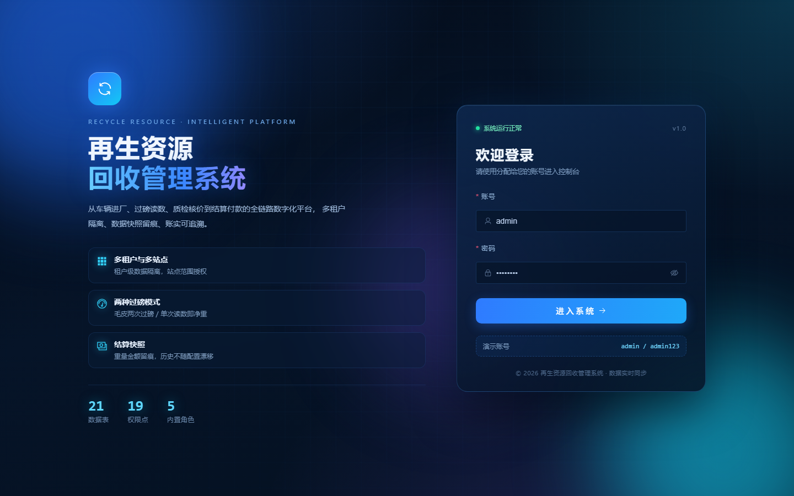 | 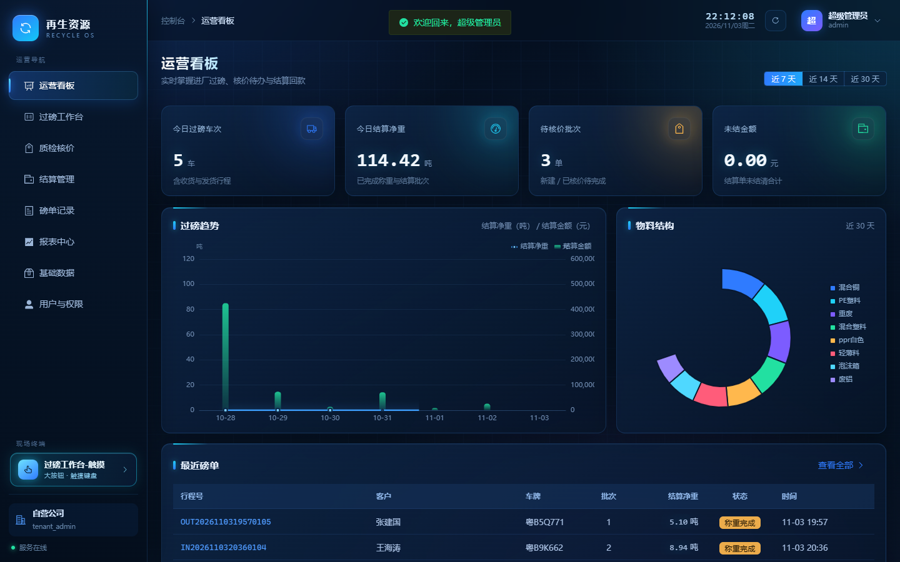 |

| 过磅工作台（多车并行） | 质检核价 |
|---|---|
| 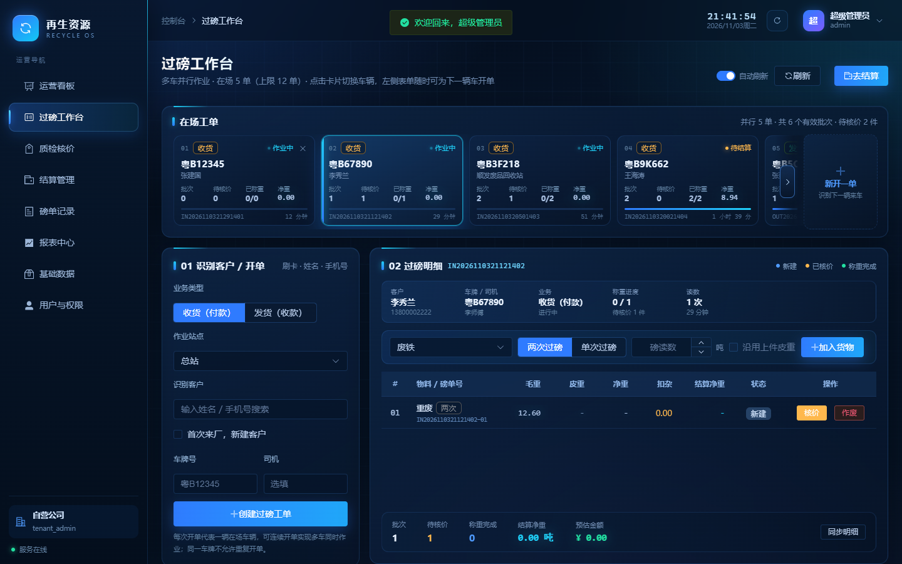 | 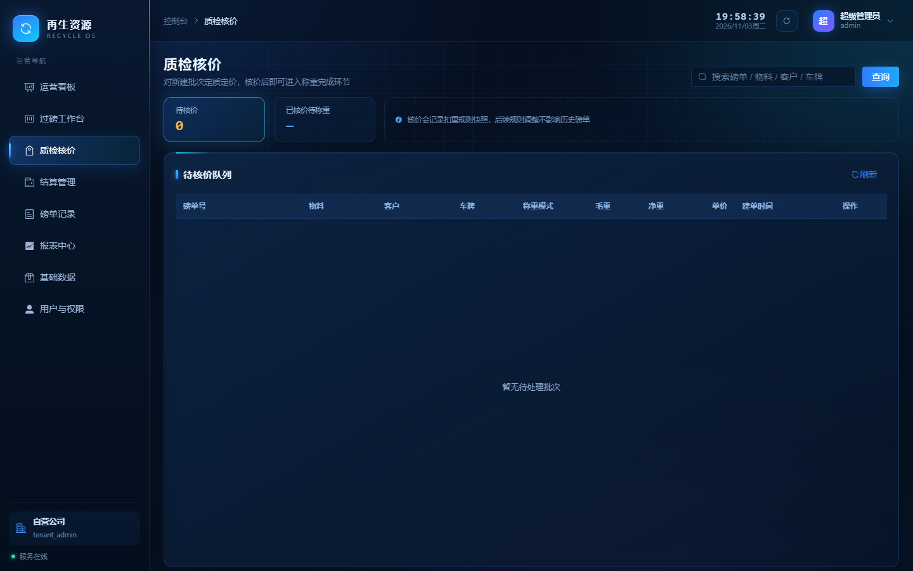 |

| 结算管理 | 报表中心 |
|---|---|
| 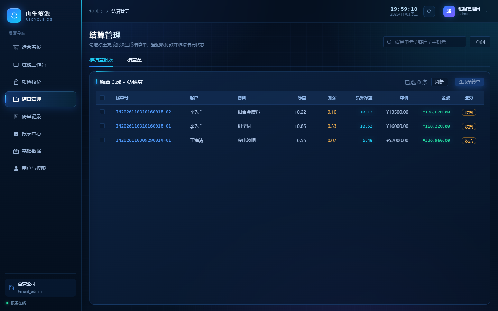 | 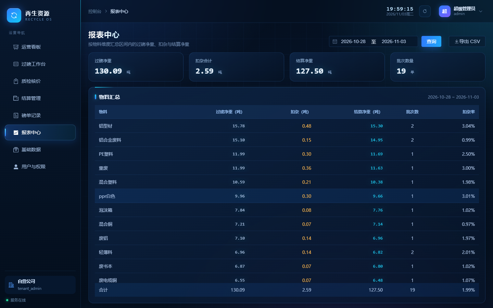 |

### 10.5 触摸终端（过磅工作台-触摸）

**背景**：磅房现场有部分操作员不会使用电脑键盘，但可以熟练操作触摸屏。标准工作台虽然功能完整，但依赖下拉搜索、文本输入、表格小按钮，对这类操作员门槛过高。因此单独提供一套**零键盘**的触摸工作台，与标准工作台共用同一套后端接口与状态机，数据完全互通。

**入口**：左侧导航「现场终端 → 过磅工作台-触摸」，路由 `/touch`（独立全屏布局，不套用控制台侧边栏，权限复用 `weigh:create`）。顶栏提供全屏切换与返回控制台。

**交互设计原则**

| 原则 | 落地方式 |
|---|---|
| 零键盘 | 全部输入走屏幕键盘：数字、手机号、车牌（省份 + 字母数字）；不出现任何需要聚焦打字的输入框 |
| 大触控目标 | 关键按键 ≥ 64px，主操作按钮 ≥ 66px；卡片整块可点，不依赖图标小按钮 |
| 分步引导 | 一次只呈现一个决策：登记来车 → 选物料 → 录毛重 → 核价 → 称皮重 → 完成结果，每步都有大号「上一步/返回」 |
| 数据大字化 | 磅读数用 44~82px 等宽字显示，带青蓝辉光；核价结果即时联动显示净重/扣杂/结算净重/预估金额 |
| 状态一眼可辨 | 车辆卡与批次行用色块标签区分「在办 / 待结算 / 已核价 / 称重完成」；待办批次整行高亮并带「核价 ›」「称皮重 ›」行动提示 |
| 防误触 | 作废等破坏性操作走「二次确认面板」，确认按钮为红色独立大按钮；提交中锁定重复点击；按键按下有位移与震动反馈 |

**核心组件**

| 组件 | 职责 |
|---|---|
| `components/touch/TouchKeypad.vue` | 触摸键盘，`mode` 支持 `decimal`（重量，4 位整数 + 2 位小数）、`int`（单价）、`phone`（11 位手机号）、`plate`（A-Z + 0-9，6×6 网格）；右侧固定「退格 / 清空 / 确定」竖列，确定键占 1.6 行高 |
| `components/touch/TouchSheet.vue` | 全屏遮罩面板，用于手机号、车牌、二次确认；支持 `normal / wide` 两档宽度 |

键盘内部维护 `inner` 缓冲并与 `v-model` 双向同步，避免连点读到未更新的 props 丢字符；每次按键用正则做增量校验（如 `^\d{0,4}(\.\d{0,2})?$`、`^[\u4e00-\u9fa5]?[A-Z0-9]{0,7}$`），非法字符直接忽略，因此不可能输入出非法读数。

**页面状态机**

`panel` 取值：`newTrip`（登记来车）→ `trip`（本车批次台）→ `material`（选物料）→ `weight`（录毛重）→ `price`（核价）→ `tare`（录皮重）→ `receipt`（完成结果）。

| 步骤 | 交互要点 |
|---|---|
| 登记来车 | 业务类型两张卡（收货/发货）；客户头像式大卡网格，可「按手机号找」或「新客户登记」；车牌可选，点开省份 + 字母数字键盘 |
| 选物料 | 分类胶囊 + 物料大卡网格，卡片直接显示默认单价，点一下即进入下一步 |
| 录毛重 | 两次/单次过磅双卡切换；大号读数屏；有可用皮重时出现「沿用上件皮重」整条开关，开启后数字键置灰但仍可「使用该皮重 · 下一步」 |
| 核价 | 单价与扣杂两个大字段点选切换编辑焦点；扣杂方式三选一（不扣杂 / 按比例扣重 / 固定扣重）；扣重基数（净重/毛重）一键切换；底部实时算净重、扣杂、结算净重、预估金额 |
| 称皮重 | 点击批次行的「称皮重 ›」进入，输入皮重即预览净重与金额，确认后完成并给出结果页 |
| 完成结果 | 大号对勾 + 毛重/皮重/净重/扣杂/结算净重/金额 + 本车累计，两个出口「返回本车 / 继续加货」 |

**业务规则补充**

1. **单次过磅自动收口**：单次过磅读数即净重，核价成功后立即调用 `complete`，直接进入结果页，省掉一次往返。
2. **新客户以手机号为准**：现场只要求输入 11 位手机号，系统自动登记为「散客 + 手机尾号 4 位」，避免拼音/汉字输入门槛；完整姓名可在标准工作台补录。
3. **沿用上件皮重**：直接从当前工单最后一条皮重读数取 `end_reading_id` 复用，同车多货不必重复称皮重。
4. **在场车辆上限与同车牌唯一**：沿用服务端 `MAX_ACTIVE_TRIPS=12` 与车牌去重规则，触摸端在达到上限时禁用「新车辆」卡并给出提示。
5. **轮询同步**：15s 轮询在场车辆，仅在「本车批次台」且无弹层/无写操作时刷新，避免打断正在进行的键盘输入。

**界面预览**

| 触摸台（在场车辆 + 本车批次） | 登记来车 |
|---|---|
| 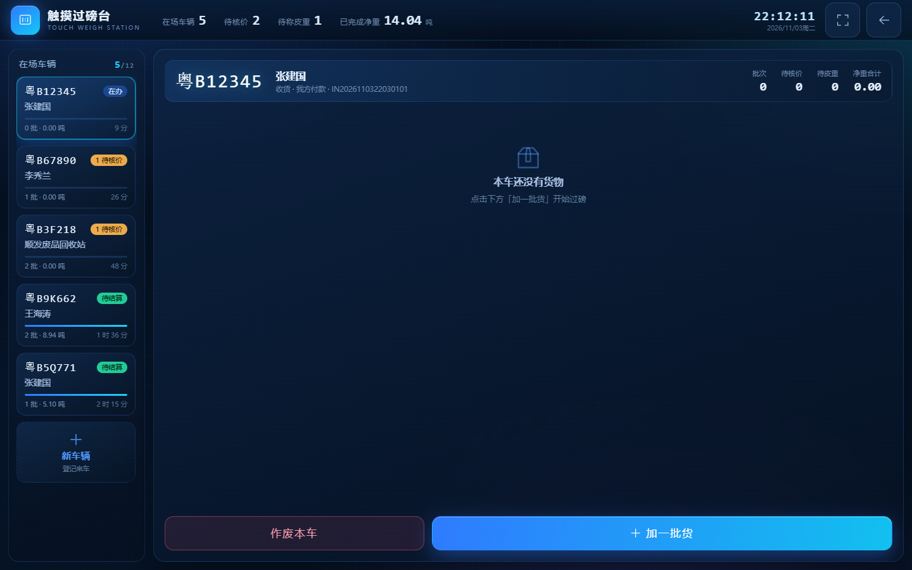 | 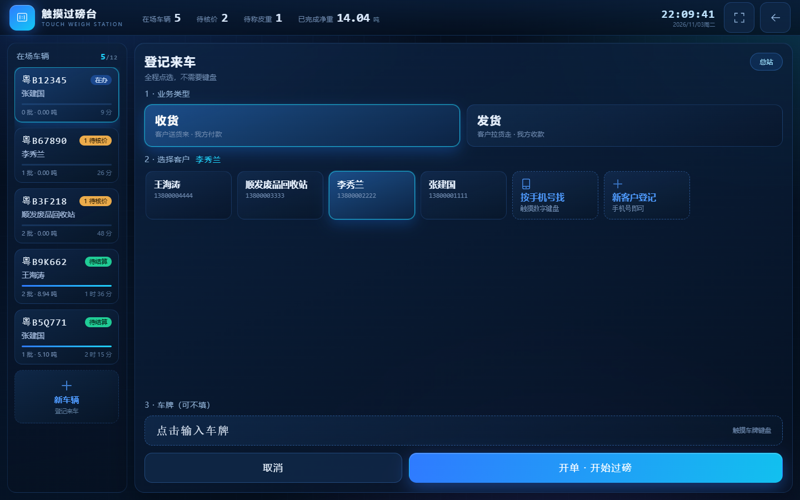 |

| 选物料 | 录毛重（触摸键盘） |
|---|---|
| 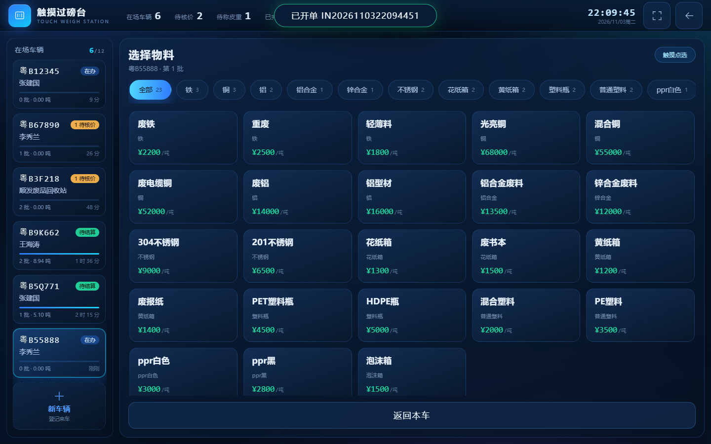 | 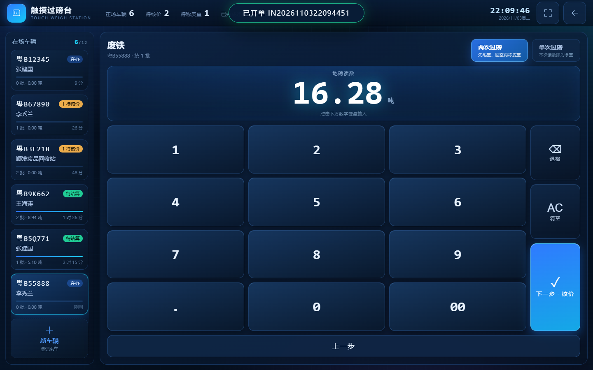 |

| 核价（扣杂与金额实时联动） | 完成结果 |
|---|---|
| 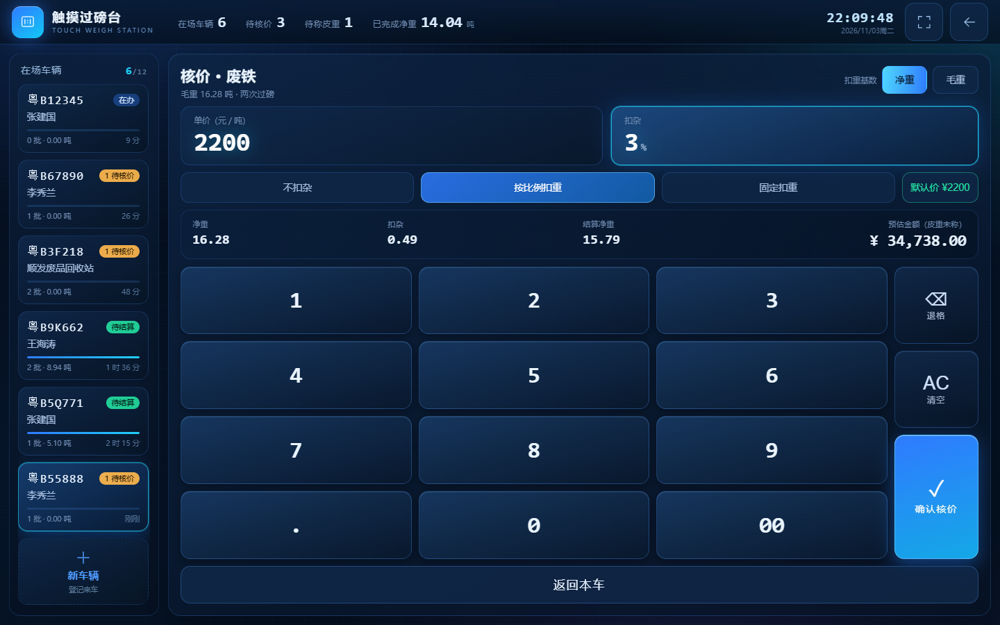 | 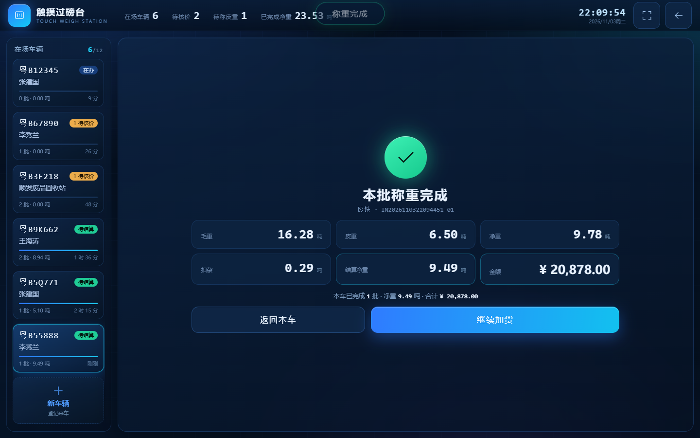 |

---

## 十一、非功能设计

### 11.1 配置与安全

- 全部配置来自 `.env`，`Settings` 在启动时校验（JWT 密钥长度不足直接失败）
- `.env` 已加入 `.gitignore`，仓库仅保留 `.env.example` 占位
- CORS 显式来源白名单，生产禁用通配符
- 密码 bcrypt(10)；响应不返回堆栈，只返回规范化错误码
- 站点范围、租户条件双重校验，防越权

### 11.2 日志与可观测

- 结构化 JSON 日志：`ts/level/logger/msg/request_id` + method/path/status/cost_ms
- 每请求生成 `X-Request-ID` 并回写响应头，前端报错可凭 ID 定位
- 不记录密码、令牌等敏感字段

### 11.3 数据一致性

- 结算创建对批次加 `SELECT ... FOR UPDATE` 行锁，防并发重复结算
- 多步写入（结算头 + 明细 + 批次状态）在同一事务提交，异常自动回滚
- 唯一索引兜底：`uk_weigh_item`、`uk_ticket_no`、`uk_settle_no`

### 11.4 性能

- 连接池（10 + 溢出 20）+ `pool_pre_ping`
- 列表查询均带 `(tenant_id, status, create_time)` 类索引
- 看板聚合走 SQL `GROUP BY`，避免 N+1；前端 ECharts 懒加载分包

---

## 十二、运行与部署

### 12.1 后端

```bash
cd backend
cp .env.example .env        # 填写数据库密码与 JWT_SECRET
python scripts/init_db.py   # 首次：建库建表 + 种子数据
python scripts/seed_demo.py # 可选：生成最近 7 天演示业务数据
uvicorn app.main:app --host 0.0.0.0 --port 8000
# API 文档：http://127.0.0.1:8000/api/docs
```

### 12.2 前端

```bash
cd frontend
npm install
npm run dev                 # http://127.0.0.1:5173
npm run build               # 产物 dist/，交由 Nginx 托管
```

### 12.3 生产要点

- Nginx：静态托管 `dist`，`/api` 反代 8000；开启 HTTPS 后设置 `COOKIE_SECURE=true`
- 关闭 `--reload`，用 `uvicorn --workers 4` 或 gunicorn+uvicorn worker
- `JWT_SECRET` 使用 32 字节以上随机值；数据库账号改为最小权限专用账号
- 健康检查接 `/health`，就绪检查接 `/ready`

---

## 十三、验证结果

已执行端到端冒烟（`backend/scripts/smoke_test.py`）：

| 检查项 | 结果 |
|---|---|
| 健康检查 | ok |
| admin 登录 | 成功，权限 `["*"]` |
| 建行程 → 加货 10.50 吨 | 批次生成，状态新建 |
| 核价 2200 元/吨、比例扣重 2% | 状态已核价 |
| 皮重 3.50 | 净重 7.00、扣重 0.14、结算净重 6.86 ✅ |
| 生成结算单 | 金额 15092.00 元 ✅ |
| 登记付款 100 元 | pay_status=1（部分结清）✅ |
| 单次过磅 5.00 吨、固定扣 0.5 | 净重 5.00、结算净重 4.50 ✅ |
| 多货复用皮重读数 | 第二件未新增读数，正确引用 seq2 ✅ |
| 前端生产构建 | 通过（8.61s） |
| 页面渲染检查 | 登录/看板/工作台/核价/结算/报表/基础数据/用户 全部正常，控制台 0 报错 |

触摸工作台（`/touch`）端到端验证，全程仅用触摸点击，无任何键盘输入：

| 检查项 | 结果 |
|---|---|
| 菜单入口「过磅工作台-触摸」 | 侧边栏可见，点击进入全屏触摸台 |
| 新客户登记（手机号键盘 11 位） | 自动登记为「散客 + 尾号」，可继续开单 |
| 车牌触摸输入（省份 + 字母数字） | 粤B… 正确回填 |
| 两次过磅 16.28 / 皮重 6.50 | 净重 9.78、扣杂 0.29、结算净重 9.49、金额 20878.00 ✅ |
| 单次过磅 8.88 | 核价后自动完成，净重 8.88、金额 22200.00 ✅ |
| 沿用上件皮重 | 读数屏显示引用值 5.40 吨，核价成功 ✅ |
| 有批次时作废本车 | 服务端 409 拦截，工单保留 ✅ |
| 空工单作废 | 卡片数 12 → 11，工单移出触摸台 ✅ |
| 触控目标尺寸 | 车辆卡 240×102、批次行 91px 高、主按钮 65px 高 |
| 控制台报错 | 0（仅 1 条预期的 409 业务拦截） |
| 1440×900 / 1920×1080 | 两种分辨率下布局完整，无横向溢出 |

---

## 十四、后续演进建议

1. **打印与小票**：接 `weigh:print` 权限，生成批次小票 PDF/热敏打印指令
2. **硬件接入**：`sys_device` 已就绪，增加串口/RTSP 采集服务，读数自动落 `weigh_reading`
3. **客户对账**：按客户+时段的结算模式（`settle_mode=1`）与对账单导出
4. **价格体系**：浮动价接入行情源，`price_source` 记录批次，支持按日调价
5. **SaaS 化**：`tenant_id` 已全链路隔离；届时将自增主键评估切换为雪花 ID（字段类型不变）
6. **审计**：增加操作日志表，记录核价/作废/付款的 before/after
